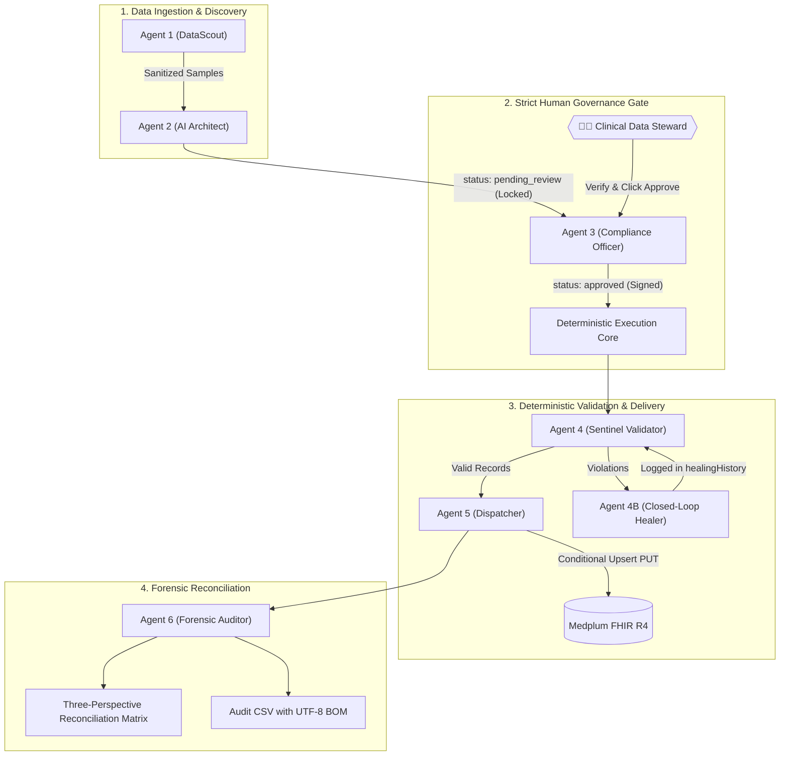

# Healthcare Data Governance Architecture & Implementation Plan

## Executive Summary: "AI Proposes, Human Governs, Deterministic Engine Executes"

In healthcare integration, uncontrolled or autonomous LLM writes to electronic health records (EHRs) introduce severe clinical liability, medical malpractice exposure, and regulatory non-compliance (HIPAA, ONC, CMS).

Our platform was architected from day one around **strict healthcare data governance, zero data loss, and mathematical idempotency**. This document details:
1. **The 10 Governance & Compliance Safeguards Already Built** into the platform.
2. **Regulatory Compliance Alignment** (HIPAA, ONC Cures Act, CMS Interoperability, HL7 FHIR R4).
3. **Proposed Next-Phase Enterprise Governance Enhancements** (Cryptographic Operator Attribution, Quarantine Queue, and Audit Log Certification).

---

## 1. What We Have Built: The 10 Core Governance Pillars



### Pillar 1: Hybrid Cognitive vs. Deterministic Separation of Concerns
* **The Clinical Risk:** LLMs are non-deterministic. If an AI hallucinates a patient birth date, drug dosage, or MRN, it risks patient injury and severe legal liability.
* **The Architecture:**
  * **Cognitive Layer (Google Gemini):** Used **strictly for reasoning** across unfamiliar column names and proposing draft mapping configurations. It never has access to write directly to databases.
  * **Deterministic Execution Core (CRE):** All record transformation is executed by audited Python code ([app/mapping/engine.py](file:///e:/ai-healthcare-etl-platform/ai-healthcare-etl-platform/app/mapping/engine.py#L462-L648)) with zero stochastic LLM variance.

---

### Pillar 2: Non-Negotiable Human-in-the-Loop Gate (Agent 3 - Compliance Officer)
* **Code Reference:** [app/mapping/engine.py#L468-L469](file:///e:/ai-healthcare-etl-platform/ai-healthcare-etl-platform/app/mapping/engine.py#L468-L469) & [app/mapping/suggest.py#L188](file:///e:/ai-healthcare-etl-platform/ai-healthcare-etl-platform/app/mapping/suggest.py#L188)
* **Enforcement:**
  ```python
  # app/mapping/engine.py
  if require_approved and cfg.status != "approved":
      raise MappingNotApproved(f"mapping '{cfg.name}' v{cfg.version} is '{cfg.status}', not approved")
  ```
* **Governance Rule:**
  1. Gemini is mathematically forbidden from self-approving mapping contracts. Outputs are hard-coded to `cfg.status = "pending_review"`.
  2. If an unapproved contract is passed to the execution engine, it immediately halts with a `MappingNotApproved` exception.
  3. Any manual edit in the UI mapping editor resets the status back to `"pending_review"`, requiring explicit re-approval.

---

### Pillar 3: Anti-Hallucination Guardrails & Source Verifiability
* **Code Reference:** [app/mapping/suggest.py#L189-L192](file:///e:/ai-healthcare-etl-platform/ai-healthcare-etl-platform/app/mapping/suggest.py#L189-L192) & [tests/test_all.py#L107-L113](file:///e:/ai-healthcare-etl-platform/ai-healthcare-etl-platform/tests/test_all.py#L107-L113)
* **Enforcement:**
  ```python
  bad = [r.source for r in cfg.rules if get_path(sample, r.source) is MISSING]
  if bad:
      raise SuggestError(f"LLM proposed nonexistent source fields: {bad}")
  ```
* **Governance Rule:**
  - If the AI invents or hallucinates any column that does not exist in the source payload, the entire proposal is aborted before the operator ever sees it.

---

### Pillar 4: Zero Data Loss Certification (FHIR Extensions)
* **Code Reference:** [app/mapping/suggest.py#L50-L52](file:///e:/ai-healthcare-etl-platform/ai-healthcare-etl-platform/app/mapping/suggest.py#L50-L52) & [docs/fhir-extensibility-and-zero-data-loss.md](file:///e:/ai-healthcare-etl-platform/ai-healthcare-etl-platform/docs/fhir-extensibility-and-zero-data-loss.md)
* **The Problem:** Traditional ETL tools drop proprietary columns (e.g., internal insurance codes, employer groups, SDoH data) that don't fit standard FHIR schemas. Dropped clinical data creates compliance liabilities under ONC Information Blocking rules.
* **The Architecture:**
  - Non-standard fields are automatically preserved in typed HL7 FHIR extensions (`extension[n].url`, `valueString`, `valueBoolean`, `valueDecimal`).
  - 100% of institutional data is retained in compliant FHIR structures.

---

### Pillar 5: Pre-Flight Sentinel Schema Validation (Agent 4)
* **Code Reference:** [app/validation.py](file:///e:/ai-healthcare-etl-platform/ai-healthcare-etl-platform/app/validation.py) & [app/upload_pipeline.py#L179-L199](file:///e:/ai-healthcare-etl-platform/ai-healthcare-etl-platform/app/upload_pipeline.py#L179-L199)
* **Enforcement:**
  - Every transformed JSON object is validated against official Pydantic FHIR R4 schema models prior to dispatch.
  - Validates value sets (e.g., `administrative-gender`: `male | female | other | unknown`), ISO-8601 timestamps, and mandatory identifier schemes.
  - Invalid records are barred from the database and routed to quarantine.

---

### Pillar 6: Immutable Self-Healing Audit Trail (Agent 4B)
* **Code Reference:** [app/mapping/heal.py](file:///e:/ai-healthcare-etl-platform/ai-healthcare-etl-platform/app/mapping/heal.py#L110-L150)
* **Enforcement:**
  - When the autonomous self-healing agent corrects a schema bug (e.g., camelCase casing errors or date format mismatches), it records an immutable audit log into `cfg.metadata["healingHistory"]`.
  - Captures the exact original Pydantic error, the surgical rule diff, model token costs, and timestamps, preserving complete audit defensibility.

---

### Pillar 7: Dual-Layer Deduplication & Mathematical Idempotency
* **Code Reference:** [app/connectors/medplum.py](file:///e:/ai-healthcare-etl-platform/ai-healthcare-etl-platform/app/connectors/medplum.py) & [app/pipeline.py](file:///e:/ai-healthcare-etl-platform/ai-healthcare-etl-platform/app/pipeline.py)
* **The Clinical Problem:** Network retries or re-uploaded files traditionally create duplicate patient records, leading to split medical charts and medication errors.
* **The Architecture:**
  - **Layer 1 (In-Memory Batch Window):** Fast `seen_ids` deduplication drops intra-batch re-transmissions.
  - **Layer 2 (Database Level):** Uses FHIR conditional upsert (`PUT /Patient?identifier=system|source_id`).
  - **Mathematical Guarantee:** $f(f(x)) = f(x)$. Re-running a 10,000-record batch 50 times yields exactly 10,000 unique records in PostgreSQL.

---

### Pillar 8: Safe Default Dry-Run Mode
* **Code Reference:** [app/main.py#L28](file:///e:/ai-healthcare-etl-platform/ai-healthcare-etl-platform/app/main.py#L28) & [app/main.py#L50](file:///e:/ai-healthcare-etl-platform/ai-healthcare-etl-platform/app/main.py#L50)
* **Enforcement:**
  - Both `PipelineRequest` and `UploadExecuteRequest` define `dry_run: bool = True` as the hardcoded default.
  - Accidental script triggers or exploratory API calls cannot mutate production clinical data without explicit, intentional override (`dry_run=False`).

---

### Pillar 9: Forensic Provenance & Three-Perspective Reconciliation (Agent 6)
* **Code Reference:** [app/upload_pipeline.py#L159-L250](file:///e:/ai-healthcare-etl-platform/ai-healthcare-etl-platform/app/upload_pipeline.py#L159-L250) & [ui/src/components/wizard/Step4ReconciliationHub.jsx](file:///e:/ai-healthcare-etl-platform/ai-healthcare-etl-platform/ui/src/components/wizard/Step4ReconciliationHub.jsx)
* **Enforcement:**
  - Every single column from the raw input file is categorized into:
    * `PRESERVED`
    * `TRANSFORMED`
    * `GENERATED`
    * `EMPTY`
    * `QUARANTINED`
  - Side-by-side verification: Source Raw Value $\leftrightarrow$ Applied Rule $\leftrightarrow$ Target Database Persisted Value.
  - Generates downloadable audit CSV with `\uFEFF` UTF-8 BOM for Microsoft Excel audit readiness.

---

### Pillar 10: Infrastructure Pacing & Denial-of-Service Protection
* **Code Reference:** [app/connectors/http.py](file:///e:/ai-healthcare-etl-platform/ai-healthcare-etl-platform/app/connectors/http.py)
* **Enforcement:**
  - Downstream clinical repositories are protected against thread exhaustion and rate crashes.
  - Automatically parses Medplum HTTP 429 `_msBeforeNext` and standard `Retry-After` headers to dynamically throttle streaming ingestion.

---

## 2. Regulatory Compliance Mapping Matrix

| Regulatory Standard | Mandate Description | How Our Platform Complies |
| :--- | :--- | :--- |
| **HIPAA Security Rule (45 CFR § 164.312(b))** | Audit Controls: Hardware, software, and procedural mechanisms to record and examine activity in systems containing ePHI. | Agent 6 Reconciliation Matrix, `healingHistory` metadata, row-by-row delivery receipts, and Excel/CSV audit export. |
| **HIPAA Privacy Rule (45 CFR § 164.530(c))** | Safeguards to prevent intentional or unintentional use or disclosure of ePHI. | `dry_run: true` safe default, isolated Docker network boundaries, credentials isolated from code. |
| **ONC 21st Century Cures Act** | Anti-Information Blocking Rule: Prohibition on withholding or dropping healthcare electronic health data. | **Zero Data Loss Certification**: All proprietary or non-standard source attributes are persisted via HL7 FHIR extensions. |
| **CMS Interoperability & Patient Access Rule** | Secure, standards-based data exchange via HL7 FHIR R4 APIs. | Strict validation against official Pydantic FHIR R4 schemas with conditional upsert idempotency. |
| **FDA / SaMD AI Software Guidance** | AI explainability and human oversight over automated decision algorithms. | **Non-Negotiable Human Gate (Agent 3)**: LLM cannot approve its own mapping logic or write directly to production records. |

---

## 3. Proposed Next-Phase Governance Enhancements (/plan)

To evolve the platform from an operator-verified system to an **enterprise cryptographically verifiable compliance engine**, we propose the following 3 enhancements:

### Enhancement A: Cryptographic Operator Attribution & Signing
* **Goal:** Upgrade the mapping approval from an anonymous `"approved"` string to a cryptographically verifiable operator signature.
* **Fields added to `MappingConfig`:**
  - `approved_by: str` (e.g., `operator@hospital.org` or username)
  - `approved_at: str` (ISO-8601 timestamp)
  - `signature_sha256: str` (SHA-256 hash computed over `target_resource + sorted(rules) + sorted(constants)`)
* **Benefit:** Absolute non-repudiation during HIPAA/CMS compliance audits.

### Enhancement B: Quarantine Stewardship & Remediation Queue
* **Goal:** Provide a dedicated compliance view for quarantined records.
* **Capability:**
  - View records that failed Pydantic schema validation.
  - Inspect exact validation error strings and row numbers.
  - One-click trigger for Agent 4B self-healing remediation or manual correction.

### Enhancement C: Formal Compliance Audit Certificate Export
* **Goal:** Generate a single, certified PDF/JSON-LD "Healthcare Interoperability Audit Certificate" summarizing:
  - Batch ID, Ingestion timestamp, Source format.
  - Total records processed, Quality rate, Quarantine count.
  - Operator signature, Mapping version, and Medplum commit UUIDs.

---

## 4. Verification Plan

### Automated Tests
1. Verify `MappingNotApproved` prevents execution of unapproved contracts:
   `pytest tests/test_all.py -k test_unapproved_mapping_refused`
2. Verify anti-hallucination guardrail rejects invalid source columns:
   `pytest tests/test_all.py -k test_suggester_rejects_hallucinated_source_field`
3. Verify dry-run default prevents database writes:
   `pytest tests/test_all.py -k test_pipeline_dry_run_writes_nothing`
4. Run full test suite:
   `pytest`

### Manual Verification
1. Launch UI and navigate to Ingestion Wizard.
2. In Step 3 (Mapping Review), note the `pending_review` status chip.
3. Attempting to proceed without clicking **Approve** is blocked by the UI and API.
4. Download the Step 4 Reconciliation Audit CSV and open in Microsoft Excel to confirm complete field-level lineage.
