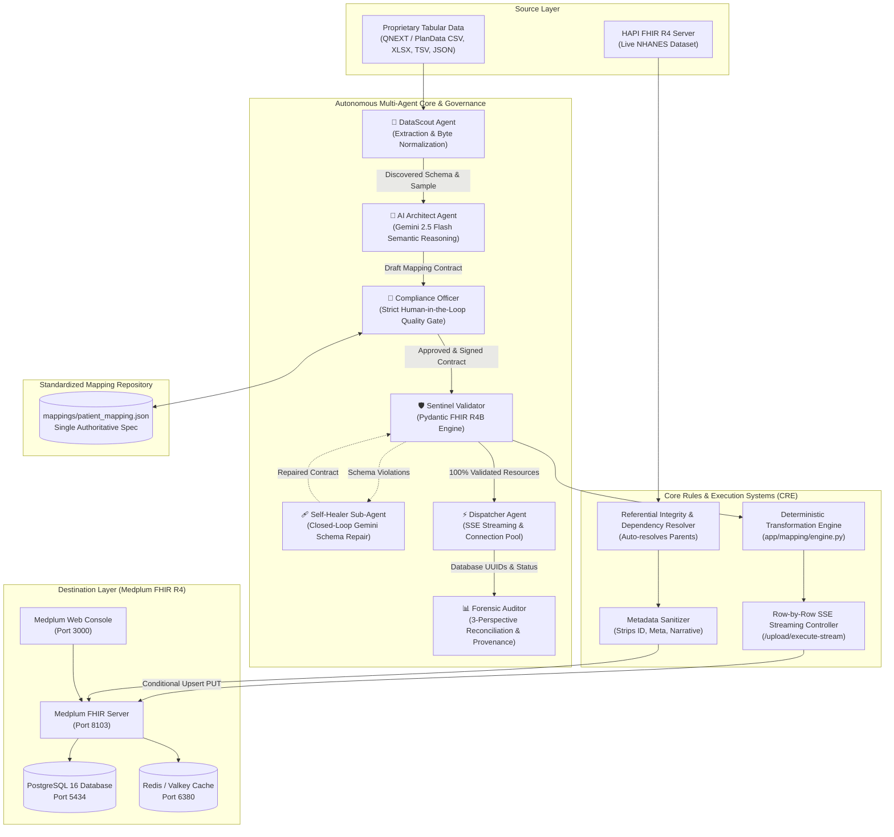
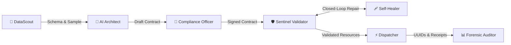
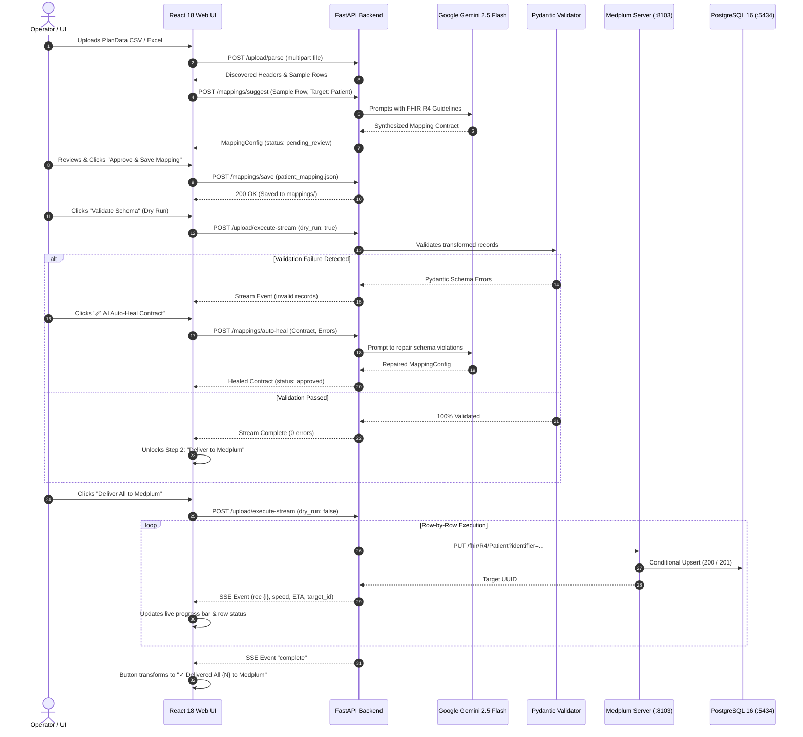

# Technical Architecture: Healthcare ETL & Autonomous Multi-Agent Platform

This document describes the end-to-end technical architecture, multi-agent relay system, execution pipelines, data streaming engine, and governance model of the **AI-Assisted Healthcare ETL Platform**.

---

## 1. System Overview & Core Philosophy

The platform bridges legacy proprietary healthcare databases (QNEXT / PlanData SQL Server exports), live clinical FHIR repositories (HAPI FHIR R4), and modern clinical data warehouses (Medplum) using a hybrid **"AI Proposes, Deterministic CRE (Core Rules Engine) Executes"** paradigm.

### Why Hybrid Architecture?
In clinical healthcare interoperability (HIPAA & HL7 FHIR compliance):
- **LLMs must never directly write unverified data to production medical databases.**
- **Autonomous Cognitive AI** (Google Gemini 2.5 Flash) is utilized exclusively to reason over schema structures, inspect unfamiliar legacy formats, synthesize transformation contracts, and autonomously repair schema violations in closed loop.
- **Deterministic Core Rules & Execution Systems (CRE)** enforce strict human-in-the-loop review, Pydantic schema validation, referential integrity resolution, and mathematical idempotency.

---

## 2. High-Level Architecture Diagram

---

## 3. The 7 Autonomous Agents: Roles & Handoff Specifications

The platform models healthcare ingestion as a sequential relay of 7 specialized autonomous agents:

| # | Agent Name | Archetype | Core Mission | Input Artifact | Output Handoff Artifact |
|---|------------|-----------|--------------|----------------|-------------------------|
| **1** | **🤖 DataScout** | Extraction & Discovery | Scans raw tabular byte streams, validates encodings, extracts de-identified sample records, and identifies primary keys. | Raw data stream / uploaded file | Discovered Schema & Sample Payload $\rightarrow$ Passes to Agent 2 |
| **2** | **🧠 AI Architect** | Semantic Reasoning | Analyzes proprietary fields against HL7 FHIR R4, synthesizes deterministic transforms, SDoH extensions, and confidence scores using Gemini 2.5 Flash. | Schema & Sample from Agent 1 | Draft FHIR R4 Mapping Contract $\rightarrow$ Passes to Agent 3 |
| **3** | **👤 Compliance Officer** | Human-in-the-Loop Governance | Guarantees regulatory compliance and clinical safety. Enforces the strict rule that AI-generated logic cannot deploy to production without operator approval. | Draft Contract from Agent 2 | Approved & Cryptographically Signed Contract $\rightarrow$ Passes to Agent 4 |
| **4** | **🛡️ Sentinel Validator** | Structural Schema Gatekeeper | Executes zero-tolerance pre-flight validation against strict Pydantic FHIR R4B models (extra='forbid', enum bindings, ISO dates). | Signed Contract & Source Records | 100% Validated FHIR Resources $\rightarrow$ Passes to Agent 5 (or invokes 4B on error) |
| **4B**| **🩹 Self-Healer** | Autonomous Schema Repair | Diagnoses exact Pydantic schema validation errors, queries Gemini in a closed loop, auto-corrects field casing and enum conversions, and re-validates. | Error Diagnostics from Agent 4 | Repaired & Certified Mapping Contract $\rightarrow$ Returns to Agent 4 |
| **5** | **⚡ Dispatcher Agent** | Transactional Streaming Engine | Delivers validated resources into Medplum's PostgreSQL database using high-speed Server-Sent Event (SSE) streaming and idempotent conditional upserts. | Validated Resources from Agent 4 | Target Medplum UUIDs & Transaction Receipts $\rightarrow$ Passes to Agent 6 |
| **6** | **📊 Forensic Auditor** | Provenance & Reconciliation | Performs end-to-end provenance certification. Compares raw source fields against live Medplum database fields, certifies zero data loss, and packages downloadable audit reports. | Source Attributes + Target DB State from Agent 5 | Certified Reconciliation Audit Bundle & Excel Package $\rightarrow$ Final Delivery |

---

## 4. Subsystem Breakdown

### 4.1. Cognitive AI Semantic Reasoning Engine (`app/mapping/suggest.py`)
- **Engine:** Google Gemini 2.5 Flash (`gemini-2.5-flash` / `gemini-flash-lite-latest`) via Google AI Studio API.
- **SSL Proxy Resilience:** Employs Python `truststore` native operating system SSL certificate injection (transparently executing inside corporate SSL inspection proxies).
- **Format:** Native JSON mode (`response_mime_type: "application/json"`).
- **Safety Guardrails:**
  1. **Non-Self-Approving:** Model output is hard-stamped with `"status": "pending_review"`.
  2. **Anti-Hallucination Gate:** Output is programmatically scanned; if the LLM invents any source path not present in the sample, the proposal is rejected immediately.
  3. **Case-Normalization Layer:** Auto-normalizes casing against official HL7 FHIR camelCase (e.g., `multiplebirthBoolean` $\rightarrow$ `multipleBirthBoolean`).

### 4.2. Closed-Loop AI Self-Healing Engine (`app/mapping/heal.py`)
- **Closed-Loop Trigger:** Automatically invoked when Pydantic validation catches schema violations during dry-run validation.
- **Diagnostic Ingestion:** Feeds the exact Pydantic error trace, failing payload, and current contract into Gemini.
- **Contract Correction:** Produces an updated mapping contract with corrected FHIR paths, type transforms, and enum maps.
- **Telemetry & Lineage:** Generates detailed change records (e.g. `Healed rule 'multiplebirth': target 'multiplebirthBoolean' -> 'multipleBirthBoolean'`).

### 4.3. Real-Time Row-by-Row SSE Streaming Engine (`app/main.py`)
- **Protocol:** Server-Sent Events (`text/event-stream`) via Starlette `StreamingResponse`.
- **Anti-Buffering:** Employs `X-Accel-Buffering: no` and explicit stream yielding to ensure immediate row-by-row delivery without buffer stalls.
- **Client Processing:** React `fetch` with `ReadableStreamDefaultReader` parses newline-delimited JSON chunks:
  - Event `record`: Incremental count, row result, running status counts, throughput speed.
  - Event `complete`: Final summary payload, closing the stream cleanly.
- **Abort Controller:** Supports client-side stream termination via `AbortController`.

### 4.4. Standardized Mapping Repository (`app/mapping/storage.py`)
- **Single Mapping Contract:** Replaced fragmented naming with a single authoritative specification per resource:
  $$\text{Target Resource: Patient} \longrightarrow \mathbf{mappings/patient\_mapping.json}$$
- Prevents configuration drift and ensures all auto-heals and approvals update the canonical template.

### 4.5. Upstream Source Ingestion & Dependency Resolver (`app/connectors/hapi.py` & `app/pipeline.py`)
- **Pagination Coordinator:** Paginates upstream FHIR R4 servers using `_count`, `_getpagesoffset`, and bundle `next` links.
- **Metadata Sanitization:** Strips volatile server-assigned attributes (`id`, `meta`, `text` XHTML narratives) to prevent destination ID collisions and stale narrative errors.
- **Referential Integrity Resolution:**
  $$\text{Patient/12345} \longrightarrow \text{Patient?identifier=urn:source:hapi}\mid\text{12345}$$
  Queries Medplum to verify parent existence; if missing, **automatically fetches the parent Patient from HAPI and ingests it first**, guaranteeing referential integrity.

### 4.6. Medplum Reconciliation Connector (`app/connectors/medplum.py`)
- **Authentication:** OAuth2 `client_credentials` grant with automatic token caching and renewal.
- **Conditional Upsert:** Uses `PUT /fhir/R4/{resourceType}?identifier={system}|{value}`.
  - If match count = 0: Inserts a new resource (`201 Created`).
  - If match count = 1: Updates the existing resource in-place (`200 OK`).
  - Result: 100 executions yield **0 duplicate rows** in the destination database.

---

## 5. End-to-End Sequence Diagram

---

## 6. Frontend UI Architecture

- **Stack:** React 18, Vite, Framer Motion (`MotionConfig reducedMotion="user"`), CSS Custom Properties.
- **Components:**
  - `AgentWorkflowVisualizer.jsx`: Unified 7-agent operations console with compact stepper, dual view modes, and click-to-open Agent Dossier modal.
  - `AgentLiveFeed.jsx`: Sequential animated execution feed with task checklists, duration tracking, collapsed 1-line cards, and accessible `aria-live` status reporting.
  - `agentSimulator.js`: Pure simulation engine for demonstration mode (`?demo=1`).
  - `MappingContractViewer.jsx`: Split-view mapping review table with inline editing, confidence tags, and one-click unmapped extension assignment.
  - `ReconciliationTable.jsx`: 3-perspective audit inspector (reconciliation diff matrix, live destination query, raw JSON).
- **High-Density Table Controls:** Client-side type-to-search, status filtering pills, and pagination controls (10/15/25/50/100).
- **Excel BOM Export:** Generates CSV reports with UTF-8 BOM `\uFEFF` ensuring seamless compatibility with Microsoft Excel across all operating systems.

---

## 7. Security & Compliance Architecture

1. **Credentials Isolation:**
   - All credentials (`GEMINI_API_KEY`, `MEDPLUM_CLIENT_ID`, `MEDPLUM_CLIENT_SECRET`) reside in `.env`.
   - `.env` and all `.env.*` files are strictly excluded from version control via `.gitignore`.
2. **Network Isolation:**
   - Medplum Server (`8103`) and Web App (`3000`) communicate internally with PostgreSQL (`5434`) and Redis (`6380`) over isolated Docker network bridges.
3. **Data Loss Prevention:**
   - Pre-flight validation gate blocks unverified writes to Medplum.
   - Non-destructive conditional upserts ensure zero duplicate rows.
