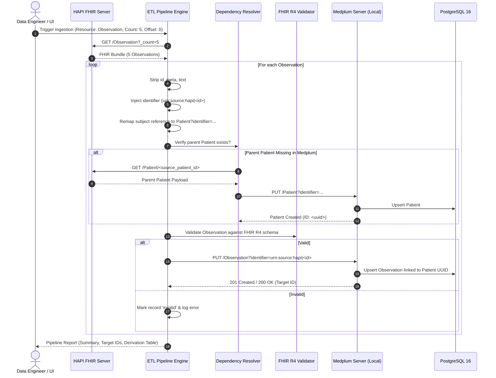

# Technical Architecture: Healthcare ETL & AI Ingestion Platform

This document describes the end-to-end technical architecture, system design, data flows, and security model of the **AI-Assisted Healthcare ETL Platform**.

---

## 1. System Overview & Core Philosophy

The platform bridges legacy non-standard healthcare data, live FHIR repositories (HAPI FHIR), and modern clinical data platforms (Medplum) using a hybrid **"AI Proposes, CRE (Core Rules Engine) Executes"** paradigm.

### Why Hybrid Architecture?
In clinical healthcare integration (HIPAA / HL7 FHIR compliance):
- **LLMs must never directly write unverified data to production medical databases.**
- **Autonomous Cognitive AI** (Google Gemini 3.5 Flash) is utilized exclusively to reason over schema structures, inspect unfamiliar formats, and propose transformations.
- **Deterministic Core Rules & Execution Systems (CRE)** enforce human approval, schema validation, dependency resolution, and mathematical idempotency.

---

## 2. High-Level Architecture Diagram

```mermaid
flowchart TD
    subgraph Sources["Source Layer"]
        HAPI["HAPI FHIR R4<br/>(Live NHANES Dataset)"]
        Legacy["Legacy Healthcare Data<br/>(Custom JSON / EHR feeds)"]
    end

    subgraph AI["Cognitive Layer"]
        Gemini["Google Gemini 3.5 Flash<br/>(AI Schema Mapping Agent)"]
    end

    subgraph CRE["Core Rules & Execution Systems (CRE)"]
        Coord["Ingestion & Paging Coordinator<br/>(HapiClient)"]
        Sanitizer["Metadata Sanitizer<br/>(Strips ID, Meta, Narrative)"]
        DepResolver["Referential Integrity & Dependency Resolver<br/>(Auto-resolves Parents)"]
        Validator["FHIR R4 Semantic Quality Gate<br/>(fhir.resources)"]
        Reconciler["Reconciliation & Idempotency Connector<br/>(OAuth2 & Conditional Upsert)"]
    end

    subgraph Destination["Destination Layer"]
        MedplumServer["Medplum FHIR Server<br/>(Port 8103)"]
        MedplumApp["Medplum Web Console<br/>(Port 3000)"]
        Postgres[("PostgreSQL 16 Database<br/>Port 5434")]
        Redis[("Redis / Valkey Cache<br/>Port 6380")]
    end

    HAPI --> Coord
    Legacy -.-> Gemini
    Gemini -->|Proposes MappingConfig<br/>(Status: pending_review)| Sanitizer
    Coord --> Sanitizer
    Sanitizer --> DepResolver
    DepResolver --> Validator
    Validator --> Reconciler
    Reconciler -->|Conditional PUT| MedplumServer
    MedplumServer --> Postgres
    MedplumServer --> Redis
    MedplumApp --> MedplumServer
```

---

## 3. Subsystem Breakdown

### 3.1. AI Schema Mapping Agent (`app/mapping/suggest.py`)
- **Engine:** Google Gemini (`gemini-3.5-flash`) via Google AI Studio Generative Language API.
- **Transport:** HTTPX with `truststore` native operating system SSL certificate injection (enabling flawless execution inside corporate SSL inspection proxies).
- **Format:** Native JSON mode (`response_mime_type: "application/json"`).
- **Safety Guardrails:**
  1. **Non-Self-Approving:** Model output is hard-stamped with `"status": "pending_review"`.
  2. **Anti-Hallucination Gate:** Output is programmatically scanned; if the LLM invents any source path not present in the sample, the proposal is rejected immediately.

### 3.2. Source Ingestion & Paging Coordinator (`app/connectors/hapi.py`)
- Paginates upstream FHIR R4 servers using `_count`, `_getpagesoffset`, and bundle `next` links.
- **In-Batch Uniqueness:** Maintains an in-memory `seen_ids = set()` to prevent processing duplicate resources within the same batch.
- Supports offset-based pagination to fetch consecutive unique batches across runs.

### 3.3. Metadata Sanitizer & Identifier Engine (`app/pipeline.py`)
- **Metadata Sanitization:** Strips volatile server-assigned attributes (`id`, `meta`, `text` XHTML narratives) to prevent destination ID collisions and stale narrative errors.
- **Idempotent Identity Derivation:** Stretches a deterministic source identifier:
  $$\text{Identifier} = \text{urn:source:}\{\text{source\_system}\} \mid \{\text{source\_id}\}$$
  Example: `urn:source:hapi|nhanes-120412`.

### 3.4. Referential Integrity & Dependency Resolver (`app/pipeline.py`)
Clinical resources (`Observation`, `Condition`, `Encounter`) possess foreign-key references to parent patients.
1. **Cross-Resource Reference Remapping:**
   Converts relative references into standard FHIR conditional references:
   $$\text{Patient/12345} \longrightarrow \text{Patient?identifier=urn:source:hapi}\mid\text{12345}$$
2. **Automated Parent Resolution:**
   Before delivering a clinical resource, the engine queries Medplum to verify if the parent `Patient` exists. If missing, the engine **automatically fetches the parent Patient from HAPI and ingests it first**, guaranteeing that referential integrity is never broken.

### 3.5. Semantic Validation Quality Gate (`app/validation.py`)
- Powered by `fhir.resources` (FHIR R4B specification models).
- Inspects every payload against formal HL7 schemas before attempting destination delivery.
- Isolated failure handling: A validation failure on one record logs a warning and isolates that record without halting the batch.

### 3.6. Medplum Reconciliation Connector (`app/connectors/medplum.py`)
- **Authentication:** OAuth2 `client_credentials` grant with automatic token caching and pre-expiration renewal.
- **Conditional Upsert:** Uses `PUT /fhir/R4/{resourceType}?identifier={system}|{value}`.
  - If match count = 0: Inserts a new resource (`201 Created`).
  - If match count = 1: Updates the existing resource in-place (`200 OK`).
  - Re-running the pipeline 100 times results in **0 duplicate rows** in the destination database.

### 3.7. Schema-Agnostic Dynamic Extraction & Reconciliation Engine (`app/pipeline.py` & `ui/src/components/ReconciliationTable.jsx`)
- **Universal Field Extractor (`format_dynamic_value`):** Recursively decodes nested FHIR structures (`HumanName`, `CodeableConcept`, `Quantity`, `Reference`, `Identifier`, `Period`, `Address`, `ContactPoint`) and arbitrary nested JSON payloads into human-readable text.
- **Dynamic Field Labeling (`get_field_display_label`):** Translates camelCase and snake_case field keys into clean clinical titles, operating with zero hardcoding across ANY source, destination, or resource category.
- **Reconciliation & Derivation Matrix:**
  - Dynamic union of source and destination key spaces.
  - Automatically identifies field disposition: `preserved`, `transformed`, `scoped_identity`, `remapped_reference`, `sanitized`, `generated`, or `dropped`.
- **Live Database Verification (`GET /medplum/live/{resource_type}/{resource_id}`):**
  - Allows instantaneous live query verification against the Medplum FHIR R4 server to confirm live commit timestamp, version ID, and persisted schema attributes.

---

## 4. End-to-End Clinical Data Flow



---

## 5. Security & Network Architecture

1. **Credentials Isolation:**
   - All credentials (`GEMINI_API_KEY`, `MEDPLUM_CLIENT_ID`, `MEDPLUM_CLIENT_SECRET`) reside in `.env`.
   - `.env` and all `.env.*` files are strictly excluded via `.gitignore`.
2. **Corporate Proxy / SSL Interception:**
   - Employs Python `truststore` to load the host operating system's native certificate authorities, transparently bypassing self-signed corporate proxy certificate warnings.
3. **Network Boundary:**
   - Medplum Server (`8103`) and Web App (`3000`) communicate internally with PostgreSQL (`postgres:5432`) and Valkey (`redis:6379`) over an isolated Docker bridge network.
   - Host port mappings are isolated (`5434` for Postgres, `6380` for Redis) to prevent conflicts with native Windows services.

---

## 6. Zero-Data-Loss & FHIR Extensibility Strategy

For complete details on the **HL7 FHIR 80/20 Pareto principle**, official FHIR extension specifications, and how the platform guarantees 100% preservation of proprietary, institutional, and unknown columns without data loss, see:
- [HL7 FHIR Extensibility & Zero-Data-Loss Architectural Strategy](fhir-extensibility-and-zero-data-loss.md)


