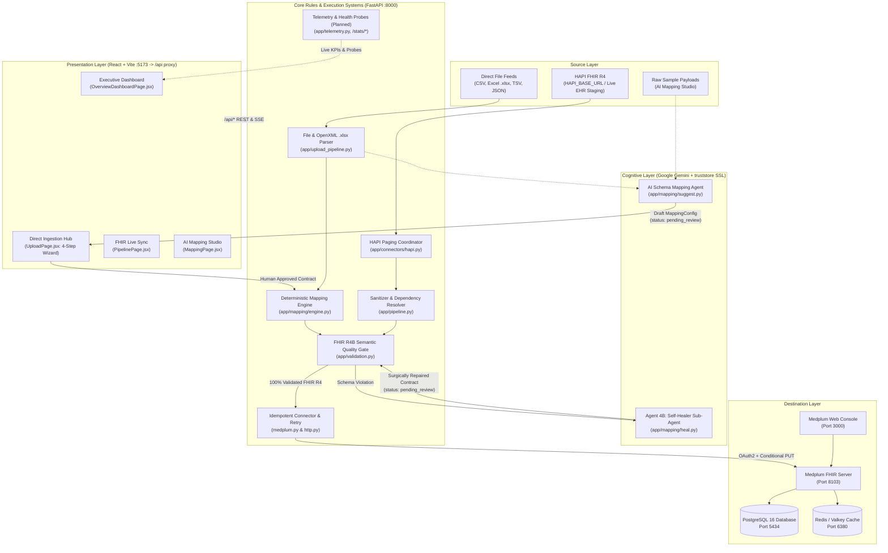
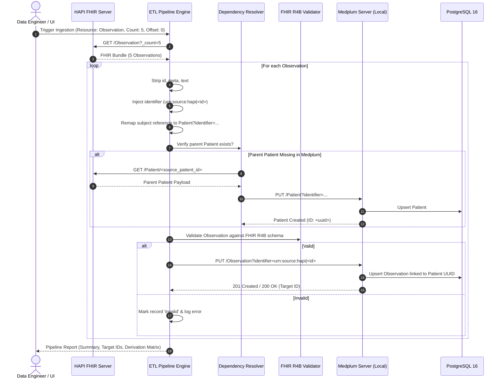
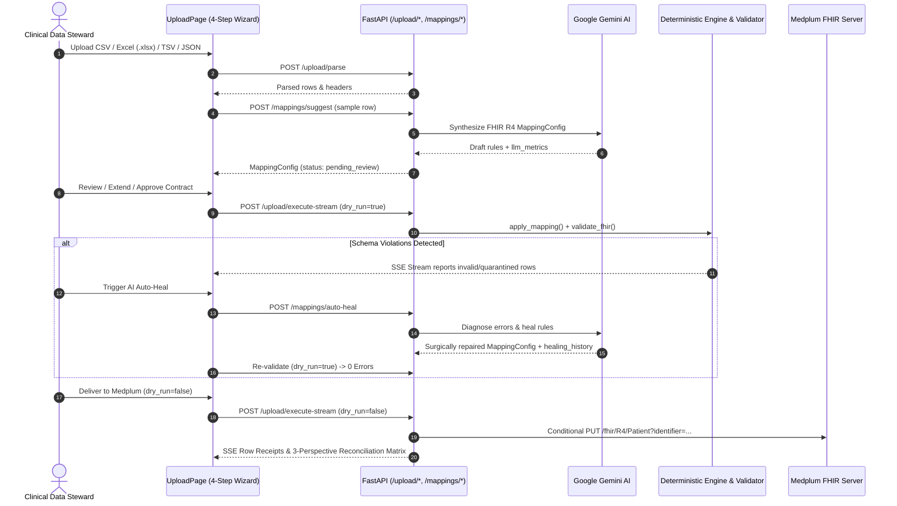

# Technical Architecture: Healthcare ETL & AI Ingestion Platform

This document describes the end-to-end technical architecture, system topology, multi-channel ingestion workflows, governance guardrails, and observability design of the **AI-Assisted Healthcare ETL Platform**.

---

## 1. System Overview & Core Philosophy

The platform bridges flat healthcare exports (`CSV`, `TSV`, native Excel `.xlsx`, `JSON`), upstream FHIR repositories (HAPI FHIR R4), and modern clinical data platforms (Medplum) using a hybrid **"AI Proposes, Human Governs, CRE (Core Rules Engine) Executes"** paradigm.

### Why Hybrid Architecture?
In clinical healthcare integration (HIPAA / HL7 FHIR / ONC Cures Act compliance):
- **LLMs must never directly write unverified data to production medical databases.**
- **Autonomous Cognitive AI** (Google Gemini via `GEMINI_MODEL`, defaulting at runtime in `get_settings()` to `gemini-flash-lite-latest` with a fallback chain to `gemini-3.5-flash-lite` and `gemini-flash-latest`) is utilized exclusively to reason over unfamiliar schemas, synthesize draft transformation contracts, and surgically diagnose validation failures.
- **Deterministic Core Rules & Execution Systems (CRE)** enforce explicit human approval (`status == "approved"`), FHIR R4/R4B schema validation, dependency resolution, HTTP 429 rate-limit resilience, and mathematical idempotency.

---

## 2. High-Level Architecture Diagram

---

## 3. Subsystem Breakdown

### 3.1. AI Schema Mapping Agent (`app/mapping/suggest.py`)
- **Engine:** Google Gemini Generative Language API (`v1beta/models/{model}:generateContent`).
- **Model Resolution & Resilience:** Configured via `GEMINI_MODEL` in `app/config.py` (`Settings` class default `gemini-3.5-flash`; runtime `get_settings()` default `gemini-flash-lite-latest`), with automatic fallback across `gemini-flash-lite-latest`, `gemini-3.5-flash-lite`, and `gemini-flash-latest` on HTTP `404`/`429`/`503` or timeouts.
- **Transport:** `httpx.Client` with `truststore.inject_into_ssl()` loading the host operating system's native certificate authorities for corporate SSL inspection proxies.
- **Format & Telemetry:** Native JSON mode (`response_mime_type: "application/json"`); records token usage, latency, and USD cost into `cfg.metadata["llm_metrics"]`.
- **Safety Guardrails:**
  1. **Non-Self-Approving:** Model output is forced to `"status": "pending_review"`.
  2. **Anti-Hallucination Gate:** Output rules are checked with `get_path(sample, r.source)`; any invented source column raises `SuggestError`.
  3. **Canonical Case Normalization:** Rule target paths are normalized against `_FHIR_FIELD_CASE_MAP` (e.g., `multiplebirthBoolean` $\rightarrow$ `multipleBirthBoolean`).

### 3.2. Direct File Ingestion, Deterministic Transformation & SSE Streaming (`app/upload_pipeline.py`, `app/mapping/engine.py`)
- **Multi-Format Extraction (`parse_uploaded_file`):** Parses `CSV`, `TSV`, semicolon-delimited files, standard/NDJSON `JSON`, and native Microsoft Excel `.xlsx` workbooks (`_parse_xlsx_bytes` using Python standard library `zipfile` and `xml.etree.ElementTree`).
- **Deterministic Execution Engine (`apply_mapping`):**
  - Refuses any unapproved contract (`MappingNotApproved`, surfaced as HTTP `409` in `/transform`).
  - Handles healthcare sentinel nulls (`SENTINEL_NULLS`: `NULL`, `N/A`, `NaN`, `—`, etc.), dynamic date/datetime normalization (SQL Server timestamps, US/ISO/swapped `YYYY-DD-MM`), boolean/integer/decimal coercion, and FHIR extension choice harmonization (`valueString`, `valueBoolean`, `valueDecimal`, `valueInteger`).
  - Automatically injects `urn:source:extension:{source}` URLs and standard identifier system URIs when missing.
- **Row-by-Row SSE Streaming (`POST /upload/execute-stream`):** Streams `record` events and a final `complete` summary via Server-Sent Events (`stream_uploaded_records`).
- **Adaptive Micro-Pacing:** Live batches exceeding `200` rows automatically apply a `12.0ms` inter-record delay (`pacing_delay_ms`) to prevent exhausting Medplum's 50,000-point/minute rate-limiter bucket.

### 3.3. Autonomous Closed-Loop Self-Healing Sub-Agent (`app/mapping/heal.py`, `POST /mappings/auto-heal`)
- **Diagnostic Repair (`heal_mapping_config`):** Accepts a failing `MappingConfig`, sample source row, and Pydantic/FHIR validation error traces; prompts Gemini (`temperature=0.1`) to repair broken paths, casing, or transforms.
- **Pre-Flight Re-Verification:** Temporarily evaluates `apply_mapping` + `validate_fhir` on the failed sample row, then resets `healed_cfg.status = "pending_review"` to preserve human oversight.
- **Immutable Audit Trail:** Appends repair diffs, resolved errors, model, token count, latency, and USD cost to `metadata["healing_history"]` and updates `metadata["llm_metrics"]`.

### 3.4. Source Ingestion & HAPI Paging Coordinator (`app/connectors/hapi.py`)
- Paginates upstream FHIR R4 servers using `_count`, `_getpagesoffset`, and Bundle `next` links via `request_with_retry`.
- **In-Batch Uniqueness:** Maintains an in-memory `seen_ids = set()` across pages to prevent processing duplicate resources within a run.

### 3.5. Metadata Sanitizer, Identifier Engine & Dependency Resolver (`app/pipeline.py`)
- **Metadata Sanitization (`normalize_for_target`):** Strips volatile source attributes (`id`, `meta`, `text` XHTML narratives) to prevent destination ID collisions and stale narrative errors.
- **Idempotent Identity Derivation:** Injects a deterministic scoped source identifier:
  $$\text{Identifier} = \text{urn:source:}\{\text{source\_system}\} \mid \{\text{source\_id}\}$$
  Example: `urn:source:hapi|nhanes-120412`.
- **Cross-Resource Reference Remapping:** Converts relative references (`Patient/12345`) into FHIR conditional references (`Patient?identifier=urn:source:hapi|12345`).
- **Automated Recursive Parent Resolution (`ensure_parent_resource`):** Before delivering an `Observation`, `Condition`, or `Encounter`, verifies whether referenced parent `Patient` / `Encounter` resources exist in Medplum. If missing, fetches the parent recursively from HAPI, normalizes it, and upserts it first.

### 3.6. Semantic Validation Quality Gate (`app/validation.py`)
- Powered by `fhir.resources.R4B` (`get_fhir_model_class`) plus `REQUIRED_CODES` value-set enforcement (e.g., `Patient.gender`).
- Validates every payload prior to destination delivery; invalid records are quarantined cleanly without halting the rest of the batch.

### 3.7. Medplum Reconciliation Connector & HTTP 429 Resilience (`app/connectors/medplum.py`, `app/connectors/http.py`)
- **Authentication:** OAuth2 `client_credentials` grant against `/oauth2/token` with token caching and 30-second pre-expiration renewal.
- **Conditional Upsert (`upsert`):** Uses `PUT /fhir/R4/{resourceType}?identifier={system}|{value}` (`201 Created` on insert, `200 OK` on in-place update), guaranteeing **0 duplicate rows** across repeated runs.
- **Adaptive Backoff (`request_with_retry`):** Retries `429`, `500`, `502`, `503`, `504` and parses both standard HTTP `Retry-After` headers and Medplum `OperationOutcome` `_msBeforeNext` diagnostics (+`0.5s` safety buffer, capped at `max_delay=65.0s`).

### 3.8. Schema-Agnostic Dynamic Extraction & Reconciliation Engine (`app/pipeline.py` & `ui/src/components/ReconciliationTable.jsx`)
- **Universal Field Extractor (`format_dynamic_value`):** Recursively formats nested FHIR structures (`HumanName`, `CodeableConcept`, `Quantity`, `Reference`, `Identifier`, `Period`, `Address`, `ContactPoint`) and arbitrary JSON into readable values.
- **Dynamic Field Labeling (`get_field_display_label`):** Maps known FHIR keys (`COMMON_FIELD_LABELS`) and converts camelCase/snake_case columns dynamically.
- **Mapping-Aware & FHIR-to-FHIR Derivation Matrix (`generate_dynamic_reconciliation`):** Classifies every field disposition (`preserved`, `transformed`, `scoped_identity`, `remapped_reference`, `sanitized`, `generated`, `dropped`, `empty`).
- **Live Database Verification (`GET /medplum/live/{resource_type}/{resource_id}`):** Queries Medplum directly to inspect persisted JSON and reconciliation state.

### 3.9. Presentation Layer & Executive Observability (`ui/src/` & Planned `app/telemetry.py`)
- **Application Shell (`ui/src/App.jsx`, `SidebarNav.jsx`, `TopHeader.jsx`):** Single-page React + Vite application (`:5173`) communicating with FastAPI (`:8000`) via Vite's `/api` dev proxy (`ui/vite.config.js`). Exposes 4 operational views:
  1. **Executive Dashboard (`OverviewDashboardPage.jsx`):** Command console featuring 4 KPI `MetricCard`s (`Clinical Quality Rate`, `Records Processed`, `AI Auto-Healed Rules`, `Delivery Velocity`), 3 quick-launch **Operational Workflows**, and 4 **Connected Healthcare Infrastructure** status cards.
  2. **Direct Ingestion Hub (`UploadPage.jsx`):** 4-step guided wizard (`Step1SourceIntake`, `Step2MappingContract`, `Step3QualityGate`, `Step4ReconciliationHub`) with `AgentWorkflowVisualizer`, closed-loop AI self-healing banner, in-place record editing, and multi-format CSV/JSON audit exports.
  3. **FHIR Live Sync (`PipelinePage.jsx`):** Multi-resource (`Patient`, `Observation`, `Condition`, `Encounter`) HAPI-to-Medplum sync with batch/offset pagination, mandatory dry-run gate, `localStorage` persistence, and 3-perspective record inspection.
  4. **AI Mapping Studio (`MappingPage.jsx`):** Interactive JSON sandbox for testing Gemini schema synthesis, rule editing, approval gating, and live transform previews.
- **Telemetry & Infrastructure Observability Status (Implementation Plan):**
  - *Current State:* `TopHeader.jsx` and `OverviewDashboardPage.jsx` check FastAPI liveness via `GET /health`, while the 4 executive KPI cards and Medplum/HAPI/Gemini status cards render static showcase values (`99.8%`, `1,420`, `14`, `155 rec/s`).
  - *Target Planned Architecture:* Introduce `app/telemetry.py` (`TelemetryManager` with `data/telemetry.json` atomic persistence), `GET /stats/overview`, `GET /stats/infrastructure` (concurrent async probes for Medplum `/healthcheck`, HAPI `/metadata?_summary=true`, FastAPI uptime, and Gemini key/cost metrics), `POST /stats/reset`, and synchronized state across `OverviewDashboardPage.jsx`, `TopHeader.jsx`, and `SidebarNav.jsx`. See [Section 11](#11-dynamic-executive-dashboard-kpis--infrastructure-observability) for full specifications.

---

## 4. End-to-End Clinical Data Flows

### 4.1. HAPI-to-Medplum Live Sync & Auto-Parent Resolution

### 4.2. Direct File Ingestion & Closed-Loop Self-Healing Flow

---

## 5. Security & Network Architecture

1. **Credentials Isolation:**
   - All credentials (`GEMINI_API_KEY`, `MEDPLUM_CLIENT_ID`, `MEDPLUM_CLIENT_SECRET`) reside in `.env`.
   - `.env` and all `.env.*` files (except `.env.example`) are strictly excluded via `.gitignore`.
2. **Corporate Proxy / SSL Interception:**
   - Employs Python `truststore` (`truststore.inject_into_ssl()`) to load the host operating system's native certificate authorities, avoiding insecure `verify=False` workarounds.
3. **Execution & API Guardrails:**
   - Both `PipelineRequest` and `UploadExecuteRequest` default to `dry_run: bool = True`, preventing accidental database writes.
   - `apply_mapping()` enforces `cfg.status == "approved"` (`MappingNotApproved` / HTTP `409`), and `suggest_mapping()` / `heal_mapping_config()` force `"status": "pending_review"`.
   - Vite (`http://localhost:5173`) proxies `/api/*` requests directly to FastAPI (`http://localhost:8000`), aligned with CORS (`allow_origins=["http://localhost:5173"]`).
4. **Network Boundary:**
   - Medplum Server (`8103`) and Web App (`3000`) communicate internally with PostgreSQL (`postgres:5432`) and Valkey (`redis:6379`) over an isolated Docker bridge network.
   - Host port mappings are isolated (`5434` for Postgres, `6380` for Redis) to prevent conflicts with native Windows services.

---

## 6. Zero-Data-Loss & FHIR Extensibility Strategy

For complete details on the **HL7 FHIR 80/20 Pareto principle**, official FHIR extension specifications, and how the platform guarantees 100% preservation of proprietary, institutional, and unknown columns without data loss, see:
- [HL7 FHIR Extensibility & Zero-Data-Loss Architectural Strategy](fhir-extensibility-and-zero-data-loss.md)

---

## 7. Rate Limiting, Throttling & High-Volume Ingestion Pacing

For analysis on Medplum's 50,000-point token bucket rate limiter, root-cause dissection of HTTP 429 `too-many-requests`, and the adaptive retry and pacing architecture (`app/connectors/http.py` and `pacing_delay_ms`), see:
- [HTTP 429 Rate Limiting & Throttling Strategy](http-429-rate-limiting-and-throttling.md)

---

## 8. Autonomous Multi-Agent System Architecture & Agent Roster

For the authoritative specification of the platform's **7 specialized agents** (6 sequential relay agents + 1 self-healing sub-agent), including their exact archetypes, operational task checklists, input/output schemas, and Human-in-the-Loop governance models, see:
- [Multi-Agent System Architecture & Agent Roster Specification](multi-agent-system-architecture.md)

---

## 9. Native Microsoft Excel Support & Serial Date Handling

For analysis on Microsoft Excel OpenXML date storage mechanics (serial day numbers such as `39216` and `18476`), root-cause dissection of batch quarantine failures, and the 3-layer auto-conversion architecture across the parser, engine, and UI modal, see:
- [Excel Support Architecture & Serial Date Quarantine Remediation Plan](excel-support-plan.md)

---

## 10. Field Coverage & Extension Strategy: Core Mappings vs. Extensions

For detailed technical analysis on why the AI Architect maps core clinical attributes automatically (e.g., 14 core fields) while surfacing proprietary and database audit columns as optional extensions via the **`✨ Map All Remaining Columns as Extensions`** action, see:
- [Field Coverage & Extension Strategy: Core Mappings vs. Zero-Data-Loss Extensions](field-coverage-and-extension-strategy.md)

---

## 11. Dynamic Executive Dashboard KPIs & Infrastructure Observability

For the full architectural design, mathematical KPI definitions (`Clinical Quality Rate`, `Records Processed`, `AI Auto-Healed Rules`, `Delivery Velocity`), concurrent health probe topology (`Medplum /healthcheck`, `HAPI /metadata?_summary=true`, `FastAPI`, `Gemini`), and implementation blueprint for replacing static dashboard values in `OverviewDashboardPage.jsx`, `TopHeader.jsx`, and `SidebarNav.jsx`, see:
- [Dynamic Executive Dashboard KPIs & Infrastructure Observability Plan](dynamic%20dashboard%20kpis.md)

---

## 12. Healthcare Data Governance & Operations Reference

- **Governance & Regulatory Compliance:** [Healthcare Data Governance Architecture & Implementation Plan](Governance.md)
- **Setup & Operations Guide:** [Operations & User Guide](user-guide.md)

---

## 13. Interactive Architecture & Executive Presentations

For self-contained, slide-based walkthroughs covering system topology, multi-agent relay, closed-loop self-healing, rate-limiting resilience, Excel date handling, and executive ROI/governance:
- [Interactive Technical Architecture Presentation](technical-presentation.html)
- [Executive & Technical Codebase Presentation](executive-technical-presentation.html)
- [Manager Executive Briefing Deck](manager-presentation.html)
