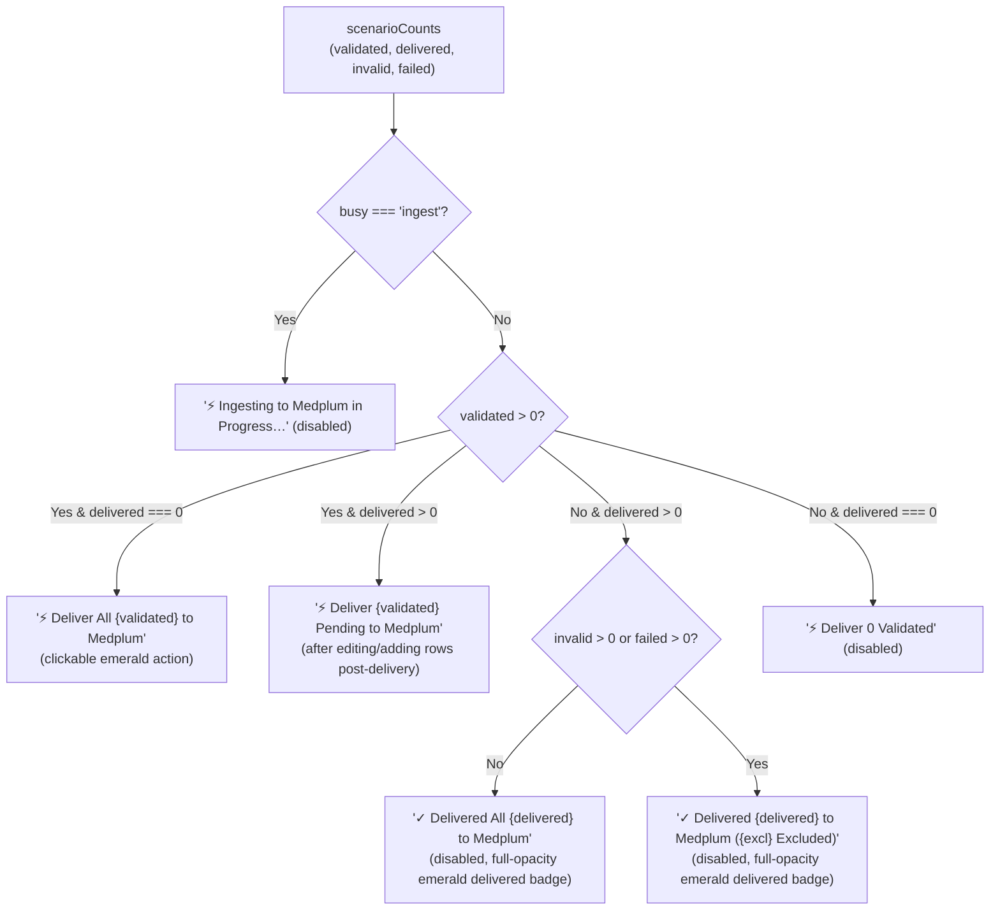

# Implementation Plan: Update Delivery Button State After Medplum Ingestion

## Goal Description
In the **Direct File Ingestion Hub** (`UploadPage.jsx`), once records finish streaming/delivering to Medplum, the primary action button on **Step 4 (`Step4ReconciliationHub.jsx`)** continues to display **`⚡ Deliver All 1000 to Medplum`** instead of transitioning to a completed **`✓ Delivered All 1000 to Medplum`** state.


This happens because `Step4ReconciliationHub.jsx` combines `validated + delivered` into `validCount` without separating pending validated rows (`dry_run`) from already-committed rows (`delivered`). The same gap exists in **Step 3 (`Step3QualityGate.jsx`)** if the operator navigates back after delivering, and in `UploadPage.jsx`'s streaming progress banner and `isDelivered` state updates.

This plan updates `Step4ReconciliationHub.jsx`, `Step3QualityGate.jsx`, `UploadPage.jsx`, and `styles.css` so that **once records are delivered, the button clearly reflects `✓ Delivered ...` and locks against duplicate 1,000-record re-runs**—while automatically re-enabling if new or edited pending rows are introduced.

---

## Design Decisions

> [!IMPORTANT]
> **Completed "Delivered" State Behavior (Locked Until New/Edited Pending Rows):**
> - Once all validated rows have been persisted (`deliveredCount > 0 && pendingValidCount === 0`), the Step 4 and Step 3 delivery buttons transition to **`✓ Delivered All {N} to Medplum`** (or **`✓ Delivered {deliveredCount} to Medplum ({attentionCount} Excluded)`** when quarantined/failed rows exist).
> - The button is **`disabled`** (`delivered-complete` CSS class with `opacity: 1` and `cursor: default`) so it visually reads as a confirmed completion state and prevents accidental re-triggering of multi-minute 1,000-record SSE uploads.
> - If the operator edits a quarantined row, adds a new row in Step 4, or clicks **Re-Validate Schema** in Step 3, `pendingValidCount > 0` becomes true again and the button re-enables as **`⚡ Deliver {pendingValidCount} Pending to Medplum`**.

---

## Proposed Changes

### State Transition Flow



---

### Wizard UI Components

#### [MODIFY] [Step4ReconciliationHub.jsx](file:///e:/ai-healthcare-etl-platform/ai-healthcare-etl-platform/ui/src/components/wizard/Step4ReconciliationHub.jsx)
1. **Separate pending vs. delivered counts** instead of adding them together:
   ```jsx
   const pendingValidCount = scenarioCounts.validated || 0;
   const deliveredCount = scenarioCounts.delivered || 0;
   const invalidCount = scenarioCounts.invalid || 0;
   const failedCount = scenarioCounts.failed || 0;
   const attentionCount = invalidCount + failedCount;
   const isDeliveredComplete = deliveredCount > 0 && pendingValidCount === 0;
   const canDeliver = pendingValidCount > 0;
   ```
2. **Compute explicit button label, class, and `disabled` state:**
   ```jsx
   let deliverLabel = `⚡ Deliver All ${fileData?.total_rows || 0} to Medplum`;
   if (busy === "ingest") {
     deliverLabel = "⚡ Ingesting to Medplum in Progress…";
   } else if (pendingValidCount > 0 && deliveredCount > 0) {
     deliverLabel = `⚡ Deliver ${pendingValidCount} Pending to Medplum`;
   } else if (pendingValidCount > 0 && attentionCount > 0) {
     deliverLabel = `⚡ Deliver ${pendingValidCount} Validated (Quarantine ${attentionCount})`;
   } else if (pendingValidCount > 0) {
     deliverLabel = `⚡ Deliver All ${pendingValidCount} to Medplum`;
   } else if (isDeliveredComplete && attentionCount > 0) {
     deliverLabel = `✓ Delivered ${deliveredCount} to Medplum (${attentionCount} Excluded)`;
   } else if (isDeliveredComplete) {
     deliverLabel = `✓ Delivered All ${deliveredCount} to Medplum`;
   }
   ```
   ```jsx
   <button
     className={`primary ${isDeliveredComplete && busy !== "ingest" ? "delivered-complete" : ""}`}
     onClick={() => onRunIngestion(false)}
     disabled={!canDeliver || !!busy}
     title={
       isDeliveredComplete
         ? `All ${deliveredCount} valid records are delivered to Medplum. Re-validate in Step 3 or edit/add a record to sync again.`
         : "Stream validated records to Medplum"
     }
     style={{
       padding: "9px 18px",
       fontWeight: 700,
       fontSize: "13px",
       ...(canDeliver && !busy
         ? {
             background: "linear-gradient(135deg, #10b981 0%, #059669 100%)",
             borderColor: "rgba(16, 185, 129, 0.4)",
             boxShadow: "0 4px 14px rgba(16, 185, 129, 0.35)",
           }
         : {}),
     }}
   >
     {deliverLabel}
   </button>
   ```
3. **Differentiate progress banner wording** using `streamProgress.mode` (`"validate"` vs. `"ingest"`):
   - `"validate"` complete $\rightarrow$ `"✓ Pre-Flight Validation Complete"`
   - `"ingest"` active $\rightarrow$ `"🚀 Delivering Records to Medplum…"`
   - `"ingest"` complete $\rightarrow$ `"✓ Live Delivery to Medplum Complete"`

---

#### [MODIFY] [Step3QualityGate.jsx](file:///e:/ai-healthcare-etl-platform/ai-healthcare-etl-platform/ui/src/components/wizard/Step3QualityGate.jsx)
- Derive `deliveredCount = report?.summary?.counts?.delivered || 0` and `pendingValidCount = report?.summary?.counts?.dry_run || 0` so Step 3's quick-action button also reflects **`✓ Delivered All ({deliveredCount}) to Medplum`** (disabled with `.delivered-complete`) if the user navigates back after delivering, or **`⚡ Ingest {pendingValidCount} Pending to Medplum`** when new/edited rows are pending.

---

### Page State & Edge-Case Fixes

#### [MODIFY] [UploadPage.jsx](file:///e:/ai-healthcare-etl-platform/ai-healthcare-etl-platform/ui/src/pages/UploadPage.jsx)
1. **Include `mode: dryRun ? "validate" : "ingest"` in `streamProgress`** and reset `setStreamProgress(null)` in `handleFileUpload` and `loadSamplePlanData`.
2. **Accurate `isDelivered` flag** in `runIngestion` (`onComplete` and batch fallback):
   ```javascript
   if (dryRun) {
     setIsValidated(invalidCount === 0);
     setIsDelivered(false);
     setCurrentStep(4);
   } else {
     setIsDelivered((event.summary?.counts?.delivered || 0) > 0);
     setCurrentStep(4);
   }
   ```
3. **Clear `isDelivered` when pending `dry_run` rows are added/edited** in `handleSaveEdit` and `handleSaveAddRecord` (`if (isNowValid) setIsDelivered(false)`).
4. **Guard `handleInitiateDelivery`:** Return early if `(scenarioCounts.validated || 0) === 0`, and open `DeliveryConfirmationModal` using `scenarioCounts.validated` (not already-delivered rows).

---

### Styling

#### [MODIFY] [styles.css](file:///e:/ai-healthcare-etl-platform/ai-healthcare-etl-platform/ui/src/styles.css)
- Add `.delivered-complete` rules (scoped separately from `PipelinePage.jsx`'s `.delivered-btn`) so the disabled delivered button stays full-opacity emerald instead of inheriting `button:disabled { opacity: 0.45 }`:
  ```css
  button.delivered-complete,
  button.delivered-complete:disabled,
  button.delivered-complete:hover {
    opacity: 1;
    cursor: default;
    transform: none;
    background: linear-gradient(135deg, rgba(16, 185, 129, 0.2) 0%, rgba(5, 150, 105, 0.28) 100%);
    border-color: rgba(52, 211, 153, 0.65);
    color: #6ee7b7;
    box-shadow: 0 0 18px rgba(16, 185, 129, 0.25);
  }
  ```

---

## Verification Plan

### Automated Tests
1. Run backend test suite:
   ```powershell
   pytest -v
   ```
2. Run frontend Vite production build:
   ```powershell
   Push-Location ui; npm run build; Pop-Location
   ```

### Manual Verification
1. Start FastAPI (`uvicorn app.main:app --reload --port 8000`) and Vite (`cd ui && npm run dev`) with Medplum running (`http://localhost:8103`).
2. Upload a CSV/Excel dataset (or load sample PlanData), approve the mapping, and validate:
   - Verify Step 4 button shows **`⚡ Deliver All {N} to Medplum`**.
3. Click **`⚡ Deliver All {N} to Medplum`** and let SSE streaming complete:
   - Verify button immediately transitions to **`✓ Delivered All {N} to Medplum`** (crisp full-opacity emerald checkmark state, locked against duplicate triggers) and progress banner reads **`✓ Live Delivery to Medplum Complete`**.
   - Navigate back to Step 3 and verify its button also reads **`✓ Delivered All ({N}) to Medplum`**.
4. Edit a quarantined row or add a record in Step 4 and confirm the button re-enables as **`⚡ Deliver 1 Pending to Medplum`**.
