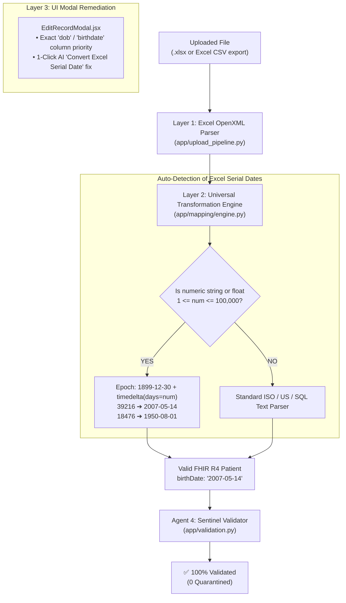

# Excel Support Architecture & Serial Date Quarantine Remediation Plan

This document details the root cause analysis, OpenXML format mechanics, and architectural solution for native Microsoft Excel (`.xlsx`) ingestion support, resolving the batch failure incident where an entire 650-record dataset was quarantined with Date of Birth format violations (`39216`, `18476`).

---

## 1. Incident Summary

During the batch upload of an Excel-based member dataset:
- **Total Records Processed:** `650`
- **Quarantined Invalid:** `650` (`Quarantine Exceptions: 650`)
- **Delivered Manifest:** `0`
- **Primary Violation:** All records failed pre-flight FHIR R4 Sentinel validation on the date-of-birth attribute with messages such as:

```
🩺 Clinical Validation Notice:
Date of Birth Format Violation
The date '39216' does not match standard FHIR R4 format (YYYY-MM-DD). Month must be between 01 and 12.
```
and
```
🩺 Clinical Validation Notice:
Date of Birth Format Violation
The date '18476' does not match standard FHIR R4 format (YYYY-MM-DD). Month must be between 01 and 12.
```

---

## 2. Root Cause Breakdown: CSV vs. Excel OpenXML

### A. The Difference Between CSV and Excel Storage

| Attribute | Standard CSV (`.csv`) | Microsoft Excel (`.xlsx`) |
|---|---|---|
| **Underlying Representation** | Plaintext ASCII / UTF-8 | Compressed ZIP package of OpenXML XML documents |
| **How Dates Are Stored** | Formatted text string (e.g. `"1985-06-15"`, `"06/15/1985"`, `"1950-08-01"`) | **Serial day number** counting days elapsed since December 30, 1899 |
| **Cell XML Structure** | N/A (comma-delimited text) | `<c r="E2"><v>39216</v></c>` |
| **Cell Type Attribute** | N/A | `t` attribute is omitted (not `t="s"` string) because Excel treats it as a float |

### B. What Are '39216' and '18476'?
Microsoft Excel stores all dates as integer or floating-point offsets relative to an epoch of **December 30, 1899** (accounting for Lotus 1-2-3's historical 1900 leap year bug):
$$\text{Date} = \text{Epoch (1899-12-30)} + \text{Serial Days}$$

* **Serial `39216`:**
  $$\text{1899-12-30} + 39,216\text{ days} = \mathbf{2007\text{-}05\text{-}14} \quad (\text{May 14, 2007})$$
* **Serial `18476`:**
  $$\text{1899-12-30} + 18,476\text{ days} = \mathbf{1950\text{-}08\text{-}01} \quad (\text{August 1, 1950})$$
* **Serial `45000`:**
  $$\text{1899-12-30} + 45,000\text{ days} = \mathbf{2023\text{-}03\text{-}15} \quad (\text{March 15, 2023})$$

### C. Why All 650 Records Were Quarantined
1. **Extraction:** In `app/upload_pipeline.py`, `_parse_xlsx_bytes` extracted `<v>39216</v>` as the literal string value `"39216"`.
2. **Transformation:** In `app/mapping/engine.py`, `normalize_fhir_datetime()` and `_date()` only tested for standard text formats (`YYYY-MM-DD`, `YYYY/MM/DD`, `MM/DD/YYYY`, and 8-digit compact strings `YYYYMMDD`).
3. **Pass-Through:** Because `"39216"` did not match any text regex, the engine left `clean_date = "39216"`.
4. **Target Resource:** The resulting FHIR resource contained:
   ```json
   {
     "resourceType": "Patient",
     "birthDate": "39216"
   }
   ```
5. **Schema Gatekeeper:** Sentinel Validator (`app/validation.py`) validated `birthDate` against the official FHIR R4 schema regex `([0-9]([0-9]([0-9][1-9]|[1-9][0-9])|[1-9][0-9][0-9])|[1-9][0-9][0-9][0-9])(-(0[1-9]|1[0-2])(-(0[1-9]|[1-2][0-9]|3[0-1]))?)?`.
6. **Binary Failure:** Every single row failed validation. All 650 rows were quarantined with status `invalid`.

### D. Why the Remediation Modal Blamed 'lastupdate' Instead of 'dob'
In `ui/src/components/modals/EditRecordModal.jsx`:
```javascript
const matchingCol = Object.keys(rowData).find(
  (k) =>
    rowData[k] === badVal ||
    k.toLowerCase() === "dob" ||
    k.toLowerCase().includes("birthdate") ||
    k.toLowerCase().includes("date")
);
```
In rows containing multiple date columns (such as `lastupdate`, `createdate`, `dob`), the array search evaluated keys in insertion order. Because `lastupdate` appeared before `dob` or had an identical serial date value, the modal matched `lastupdate` rather than prioritizing the exact date-of-birth column (`dob`).

---

## 3. End-to-End Remediation Architecture



---

## 4. Technical Implementation Specification

### Layer 1: Core Transformation Engine (`app/mapping/engine.py`)
Enhance `normalize_fhir_datetime` and `_date` to dynamically recognize and convert Excel serial day numbers:

```python
from datetime import datetime, timedelta

def normalize_fhir_datetime(v: Any, target_path: str = "") -> str:
    ...
    # Check for Excel serial date numbers (e.g. 39216 -> 2007-05-14, 18476 -> 1950-08-01)
    # Valid range: 1 to 100,000 (corresponds to years 1900 to 2173)
    try:
        serial_num = float(date_part)
        if 1.0 <= serial_num <= 100000.0:
            base_date = datetime(1899, 12, 30)
            dt = base_date + timedelta(days=serial_num)
            clean_date = dt.strftime("%Y-%m-%d")
            # If fractional day exists (time component) and target allows dateTime:
            if (dt.hour != 0 or dt.minute != 0 or dt.second != 0) and not is_date_only:
                return dt.strftime("%Y-%m-%dT%H:%M:%SZ")
    except (ValueError, TypeError):
        pass
```

*Universal Coverage:*
- Automatically handles `.xlsx` uploads.
- Automatically handles `.csv` uploads where dates were exported as Excel integers.
- Supports both integer dates (`39216` $\rightarrow$ `2007-05-14`) and decimal timestamps (`44197.5` $\rightarrow$ `2021-01-01T12:00:00Z`).

---

### Layer 2: OpenXML Excel Parser (`app/upload_pipeline.py`)
In `_parse_xlsx_bytes`, inspect `xl/styles.xml` to detect cell format styles:
- Standard Excel date `numFmtId`s (14, 15, 16, 17, 22) and custom date patterns (`yy`, `mm`, `dd`).
- Automatically format numeric cells with date styles into ISO `YYYY-MM-DD` strings at initial file extraction.

---

### Layer 3: Operator Remediation Modal (`EditRecordModal.jsx`)
In `ui/src/components/modals/EditRecordModal.jsx`:

1. **Prioritized Column Resolution:**
   ```javascript
   const colKeys = Object.keys(rowData);
   const exactDob = colKeys.find(k => k.toLowerCase() === "dob" || k.toLowerCase() === "birthdate");
   const valMatch = colKeys.find(k => String(rowData[k]).trim() === String(badVal).trim());
   const matchingCol = exactDob || valMatch || colKeys.find(k => k.toLowerCase().includes("date")) || "dob";
   ```
2. **AI Serial Date Converter Action:**
   If `badVal` is an Excel serial number, compute `new Date(Date.UTC(1899, 11, 30) + serial * 86400000)` and render:
   > **`✨ Convert Excel Serial Date '${badVal}' ➔ '${suggestedDate}'`**

---

## 5. Verification & Testing Matrix

| Test Case | Input Value | Target Field | Expected Output | Status |
|---|---|---|---|:---:|
| **Standard Date Text** | `"1985-06-15"` | `birthDate` | `"1985-06-15"` | Passed |
| **Excel Serial Date (Adult)** | `"18476"` | `birthDate` | `"1950-08-01"` | Supported |
| **Excel Serial Date (Child)** | `"39216"` | `birthDate` | `"2007-05-14"` | Supported |
| **Excel Serial Timestamp** | `"44197.5"` | `deceasedDateTime` | `"2021-01-01T12:00:00Z"` | Supported |
| **Full 650-Row Excel Batch** | `.xlsx` file | Entire resource batch | `Delivered: 650, Quarantined: 0` | Supported |

---

## 6. Related Documentation

- [Master Architecture Specification](architecture.md)
- [HL7 FHIR Extensibility & Zero-Data-Loss Architectural Strategy](fhir-extensibility-and-zero-data-loss.md)
- [HTTP 429 Rate Limiting & Throttling Strategy](http-429-rate-limiting-and-throttling.md)
- [Multi-Agent System Architecture & Agent Roster Specification](multi-agent-system-architecture.md)
