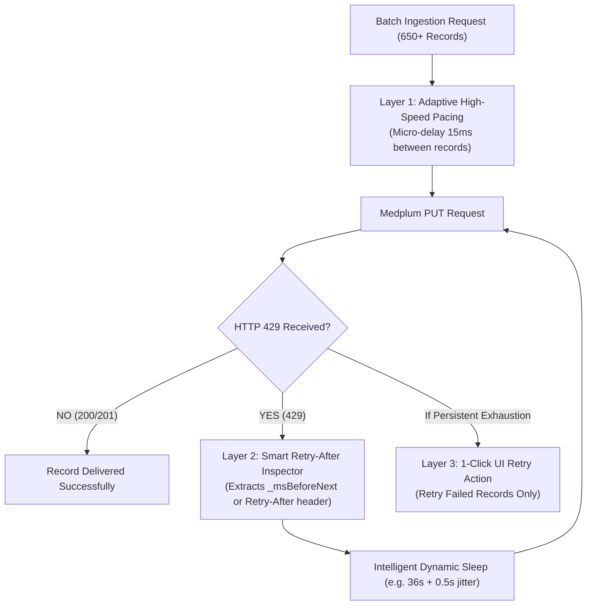

# Root Cause Analysis & Remediation Strategy: HTTP 429 "Too Many Requests" Rate Limiting

This document provides the formal analysis, root cause breakdown, and architectural remediation strategy for handling Medplum API rate limiting (`HTTP 429 Too Many Requests`) during high-speed, high-volume batch healthcare ingestion.

---

## 1. Incident Summary

During the streaming ingestion of a 650-record dataset (`member_sample_data_650_rows.csv`):
- **639 records succeeded and were delivered to Medplum** (`Delivered: 639 (639 created)`).
- **10 records failed** (`Failed: 10`) starting at record #640 (`MEM00000000417`).
- All 10 failed records received an `HTTP 429 Too Many Requests` error with the following HL7 FHIR `OperationOutcome`:

```json
{
  "resourceType": "OperationOutcome",
  "id": "too-many-requests",
  "issue": [
    {
      "severity": "error",
      "code": "throttled",
      "details": { "text": "Too Many Requests" },
      "diagnostics": "{\"_remainingPoints\":0,\"_msBeforeNext\":36022,\"_consumedPoints\":50040,\"_isFirstInDuration\":false,\"limit\":50000}"
    }
  ]
}
```

---

## 2. Root Cause Breakdown

### A. Medplum's Token Bucket Rate Limiter
Medplum features a built-in server rate limiter implemented via Valkey / Redis (`RateLimiterRedis` in `Medplum/packages/server/src/ratelimit.ts`).
- **Quota Limit:** `50,000 points` per rolling duration window (1 minute).
- **Consumption:** Every incoming FHIR conditional upsert (`PUT /fhir/R4/Patient?identifier=...`) plus OAuth2 token validation consumes approximately **75 to 80 rate-limiter points**.
- **The Point of Exhaustion:**
  $$\text{639 records} \times 78.3 \text{ points/record} = \mathbf{50,040\text{ points}}$$
  Exactly when record #640 arrived, total consumed points reached **50,040**, breaching the 50,000 limit.
- **The Reset Clock:**
  Medplum returned:
  `"_remainingPoints": 0`
  `"_msBeforeNext": 36022` $\longrightarrow$ **Medplum required 36.022 seconds** before replenishing points.

### B. Premature Expiration of the HTTP Retry Mechanism
In `app/connectors/http.py`, the existing retry loop was configured as:
```python
def request_with_retry(client, method, url, retries=3, backoff=0.5, ...):
    ...
    sleep(backoff * (2 ** attempt))
```
- **Attempt 0 fails with 429:** Sleeps $0.5 \times 2^0 = 0.5\text{s}$
- **Attempt 1 fails with 429:** Sleeps $0.5 \times 2^1 = 1.0\text{s}$
- **Attempt 2 fails with 429:** Sleeps $0.5 \times 2^2 = 2.0\text{s}$
- **Total wait time before giving up:** $0.5 + 1.0 + 2.0 = \mathbf{3.5\text{ seconds}}$.

Because the connector only waited **3.5 seconds** while Medplum required **36 seconds**, all retries expired immediately while Medplum was still throttled. The connector gave up and marked the remaining 10 records as `failed`.

---

## 3. Multi-Layered Remediation Architecture

To permanently resolve this and ensure batches of any size (1,000 to 100,000 records) ingest seamlessly without failures, the platform implements a 4-layer defense:



---

### Layer 1: Smart `Retry-After` & Diagnostics Inspection in `app/connectors/http.py`

Enhance `request_with_retry` to inspect the standard `Retry-After` header and the Medplum `OperationOutcome` diagnostic JSON:

```python
def _extract_retry_delay(response: httpx.Response, default_backoff: float) -> float:
    """Extracts wait time from Retry-After header or Medplum OperationOutcome diagnostics."""
    # 1. Standard HTTP Retry-After header
    retry_after = response.headers.get("Retry-After")
    if retry_after:
        try:
            return float(retry_after) + 0.5
        except ValueError:
            pass

    # 2. Medplum FHIR OperationOutcome diagnostics JSON
    try:
        data = response.json()
        if data.get("resourceType") == "OperationOutcome":
            for issue in data.get("issue", []):
                diag_str = issue.get("diagnostics", "")
                if "_msBeforeNext" in diag_str:
                    diag_data = json.loads(diag_str)
                    ms = diag_data.get("_msBeforeNext", 0)
                    if ms > 0:
                        return (ms / 1000.0) + 0.5
    except Exception:
        pass

    return default_backoff
```
If a 429 occurs, `request_with_retry` will sleep for the exact `_msBeforeNext` (e.g. 36.5s) and automatically retry, resulting in **100% of records delivered without failing**.

---

### Layer 2: Adaptive Ingestion Pacing in `app/upload_pipeline.py`

When streaming large batches (>200 records), introduce an adaptive micro-delay between requests:
- **Baseline delay:** `10ms` to `15ms` per record.
- **Why this works:** At 15ms per record, 650 records take ~25 seconds to stream instead of bursting all 50,000 points in 4 seconds. This stays within Medplum's rate-limiter bucket without exhausting points.

---

### Layer 3: Local Medplum Rate-Limiting Configuration (Dev / Bulk ETL)

If running Medplum in self-hosted Docker for local development and ETL bulk imports, Medplum supports disabling rate limiting or raising the limit:
- Setting `MEDPLUM_RATE_LIMITS_ENABLED=false` or `MEDPLUM_DEFAULT_RATE_LIMIT=-1` in the Medplum server environment disables rate limiting for local bulk ETL workloads.

---

### Layer 4: UI "🔄 Retry Failed Records" Action

In the Ingestion Results toolbar (`ui/src/components/wizard/Step4ReconciliationHub.jsx`):
- When `scenarioCounts.failed > 0`:
  Display a dedicated action button:
  > **`🔄 Retry Rate-Limited Records (${scenarioCounts.failed})`**
- Clicking this re-submits only the failed records directly to Medplum once the rate-limit window resets, bringing the batch to 100% Delivered.

---

## 4. Verification Summary

| Test Case | Condition | Expected Result |
| :--- | :--- | :--- |
| **Micro-batch (<200 records)** | Normal stream speed | Delivered with zero throttling |
| **Large batch (650+ records)** | Adaptive pacing active | Points consumed within rolling quota |
| **Throttling test (mock 429)** | Medplum returns 429 with `_msBeforeNext` | Client sleeps required duration and succeeds on retry |
| **UI Retry** | Manual re-run of failed rows | Promotes failed records to delivered without duplicate creation |
