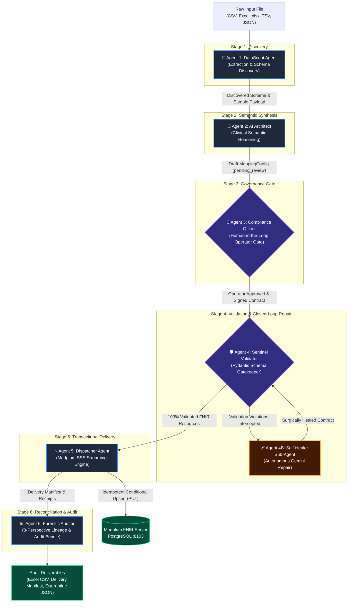

# Multi-Agent System Architecture & Agent Roster Specification

This document provides the authoritative architectural specification of the **7 specialized agents** powering the Healthcare ETL & Interoperability Platform. It covers their roles, operational tasks, engine technology stacks, input/output schemas, handoff protocols, and governance gates.

---

## 1. Executive Summary & Agent Census

To achieve autonomous, high-integrity, zero-data-loss ingestion of heterogenous healthcare records into HL7 FHIR R4, the platform operates a coordinated mesh of **6 sequential pipeline relay agents** and **1 autonomous self-healing sub-agent**:

| # | Agent Codename | Identifier | Archetype | Technology Stack | Governance Model | Code Reference |
|---|----------------|------------|-----------|------------------|------------------|----------------|
| **1** | **DataScout Agent** | `agent_1_extraction` | Extraction & Schema Discovery | Python Streaming Parser (`csv`, `openpyxl`, `json`) | Autonomous Execution | `app/upload_pipeline.py` |
| **2** | **AI Architect** | `agent_2_synthesis` | Semantic Reasoning & Mapping Synthesis | Google Gemini 2.5/3.5 Flash via REST | Autonomous Generation | `app/mapping/suggest.py` |
| **3** | **Compliance Officer** | `agent_3_governance` | Human-in-the-Loop Governance | Interactive Operator Sign-off Gate | **Strict Human Approval Gate** | `ui/src/components/UploadPage.jsx` |
| **4** | **Sentinel Validator** | `agent_4_validation` | Structural Schema Gatekeeper | Pydantic FHIR R4/R4B Model Engine | Binary Quality Gate (0 errors to pass) | `app/validation.py`, `app/mapping/engine.py` |
| **4B** | **Self-Healer Sub-Agent** | `agent_4b_healer` | Autonomous Closed-Loop Schema Repair | Gemini LLM + Surgical Diff Engine | Autonomous Closed-Loop Repair | `app/mapping/heal.py` |
| **5** | **Dispatcher Agent** | `agent_5_dispatcher` | Transactional Streaming & Ingestion | Medplum SSE Ingestion Engine | Autonomous Streaming with Backoff | `app/upload_pipeline.py`, `app/connectors/http.py` |
| **6** | **Forensic Auditor** | `agent_6_auditor` | Provenance & Reconciliation Auditor | 3-Perspective Dynamic Engine | Certified Audit Bundle Generation | `app/main.py`, `DynamicReconciliationMatrix.jsx` |

---

## 2. Multi-Agent Relay & Handoff Workflow

The ingestion pipeline executes as a strictly ordered relay. Each agent processes its domain, produces an immutable payload, and passes control to the next agent in the sequence:

---

## 3. Detailed Agent Dossier & Technical Tasks

### Agent 1: DataScout Agent (`agent_1_extraction`)
* **Archetype:** Extraction, Ingestion, and Schema Discovery
* **Technology Stack:** Python Streaming Engine (`app/upload_pipeline.py`, `pandas`, `openpyxl`, `csv`, `json`)
* **Mission:** Ingest arbitrary tabular or semi-structured healthcare data feeds, inspect byte streams, evaluate encodings, extract sanitized sample records, and construct a structured schema manifest.
* **Core Tasks:**
  1. **Encoding & Byte Stream Detection:** Inspects incoming byte streams, detecting and normalizing encodings (UTF-8, Latin-1, Windows-1252, UTF-8 BOM).
  2. **Multi-Format Parsing:** Ingests CSV, TSV, multi-sheet Excel workbooks (`.xlsx`), and line-delimited JSON.
  3. **Header Cleansing:** Trims whitespace, strips invalid characters, and normalizes headers without altering semantic meaning.
  4. **Primary Key Identification:** Evaluates column entropy and heuristics to identify candidate record identifiers (e.g., `memid`, `ssn`, `ExternalId`, `entityid`).
  5. **Sample Payload Packaging:** Extracts de-identified sample rows and packages them into a schema discovery manifest for Agent 2.
* **Input:** Raw binary file upload or database feed (`.csv`, `.xlsx`, `.tsv`, `.json`).
* **Output:** Discovered Schema Manifest and de-identified Sample Record JSON.
* **Handoff Target:** Passes discovery package directly to **Agent 2 (AI Architect)**.

---

### Agent 2: AI Architect (`agent_2_synthesis`)
* **Archetype:** Semantic Reasoning & Mapping Synthesis
* **Technology Stack:** Google Gemini 2.5/3.5 Flash via REST (`app/mapping/suggest.py`)
* **Mission:** Synthesizes an optimal transformation contract (`MappingConfig`) by reasoning over source attributes against the official HL7 FHIR R4 standard.
* **Core Tasks:**
  1. **Clinical Semantic Reasoning:** Identifies clinical and administrative concepts across proprietary column names (e.g., mapping `memdob` $\rightarrow$ `birthDate`, `memsex` $\rightarrow$ `gender`, `pat_lang` $\rightarrow$ `communication[0].language`).
  2. **Deterministic Transform Assignment:** Configures exact deterministic transformations: `date` formatting (`YYYY-MM-DD`), enum value lookups (`map`), string casing (`upper`/`lower`), and whitespace trimming (`strip`).
  3. **Zero-Data-Loss Extension Generation:** Automatically assigns non-standard, business, or unknown columns to typed FHIR extensions (`extension[n].valueString`, `valueBoolean`, `valueDecimal`) under custom or US Core URIs.
  4. **Confidence & Rationale Scoring:** Computes statistical confidence scores ($0.0 \text{ to } 1.0$) and generates clear clinical explanations for each mapping rule.
  5. **Contract Synthesis:** Emits the synthesized `MappingConfig` with status strictly set to `"pending_review"`.
* **Input:** Discovered schema inventory and sample record from Agent 1.
* **Output:** Draft `MappingConfig` JSON contract in `pending_review` status.
* **Handoff Target:** Routes the draft contract to **Agent 3 (Compliance Officer)**.

---

### Agent 3: Compliance Officer (`agent_3_governance`)
* **Archetype:** Human-in-the-Loop Governance & Regulatory Safety Gatekeeper
* **Technology Stack:** Interactive Operator Interface (`ui/src/components/UploadPage.jsx`, `ui/src/components/MappingModal.jsx`, `mappings/patient_mapping.json`)
* **Mission:** Guarantees regulatory compliance (HIPAA, ONC, CMS) by enforcing the non-negotiable rule that **no AI-generated transformation contract may run in production without human operator verification and approval**.
* **Core Tasks:**
  1. **Pipeline Execution Interception:** Halts pipeline progression at Stage 3 in status `"waiting_human"` / `"Awaiting Operator Signature"`.
  2. **Visual Contract Presentation:** Renders an interactive mapping table detailing field-by-field source columns, target FHIR paths, transform operations, confidence badges, and AI rationales.
  3. **Operator Edits & Reversion:** Allows operators to modify paths, adjust date formats, or add custom extensions. Any manual modification automatically resets the contract status to `"pending_review"`.
  4. **Approval & Cryptographic Sign-Off:** Captures operator approval, transitioning the contract to `status: "approved"` and unlocking downstream validation.
* **Input:** Draft `MappingConfig` JSON from Agent 2.
* **Output:** Signed, operator-approved `MappingConfig` (`status: "approved"`).
* **Handoff Target:** Releases the pipeline execution lock to **Agent 4 (Sentinel Validator)**.

---

### Agent 4: Sentinel Validator (`agent_4_validation`)
* **Archetype:** Structural Schema Gatekeeper & Pre-Flight Quality Gate
* **Technology Stack:** Pydantic FHIR R4/R4B Model Engine (`app/validation.py`, `app/mapping/engine.py`)
* **Mission:** Enforces zero-tolerance pre-flight validation against official FHIR R4 schemas before any record touches network or database layers.
* **Core Tasks:**
  1. **Deterministic Record Transformation:** Applies `apply_mapping` to transform source tabular rows into structured FHIR R4 JSON resources.
  2. **Pydantic Model Validation:** Enforces strict Pydantic model validation with `extra="forbid"`, blocking unmapped or illegal properties.
  3. **Value Set & Constraint Enforcement:** Validates FHIR value sets and enum bindings (e.g., `administrative-gender`: `male | female | other | unknown`), ISO-8601 date strings, and mandatory identifiers.
  4. **Binary Quality Gate:** Operates as a zero-error gate. If all records pass, advances the batch directly to Agent 5.
  5. **Exception Routing:** If validation violations occur, captures the structured error diagnostics and routes the failure payload to Agent 4B.
* **Input:** Approved `MappingConfig` from Agent 3 + Source tabular records from Agent 1.
* **Output:** 100% Validated FHIR Resource batch (or failure diagnostic payload).
* **Handoff Target:** Passes cleanly to **Agent 5 (Dispatcher Agent)** if valid; diverts to **Agent 4B (Self-Healer Sub-Agent)** upon error.

---

### Agent 4B: Self-Healer Sub-Agent (`agent_4b_healer`)
* **Archetype:** Autonomous Closed-Loop Schema Repair & Error Remediation
* **Technology Stack:** Closed-Loop Gemini LLM Diagnostic Engine (`app/mapping/heal.py`, `heal_mapping_config`)
* **Mission:** Intercepts schema validation errors and autonomously repairs mapping contracts in a closed-loop cycle without human intervention.
* **Core Tasks:**
  1. **Diagnostic Parsing:** Analyzes Pydantic error traces and schema mismatch logs (e.g. camelCase errors like `multiplebirthBoolean` vs. `multipleBirthBoolean`, string/boolean type mismatches, or missing array index notations).
  2. **LLM Diagnostic Prompting:** Prompts Gemini with the exact failed payload, schema constraints, and current mapping rules.
  3. **Surgical Diff Synthesis:** Synthesizes minimal, targeted rule repairs (correcting property case, converting transforms, adding enum fallbacks) without mutating working rules.
  4. **Closed-Loop Verification:** Re-runs `apply_mapping` and validates the candidate fix against Sentinel Validator to confirm 0 errors.
  5. **Immutable Audit Logging:** Appends the repair details to `healingHistory` for traceability and regulatory audits.
* **Input:** Pydantic validation error list, failed record sample, and active `MappingConfig`.
* **Output:** Surgically healed and validated `MappingConfig`.
* **Handoff Target:** Returns the healed contract to **Agent 4 (Sentinel Validator)** for re-validation, which then advances to **Agent 5**.

---

### Agent 5: Dispatcher Agent (`agent_5_dispatcher`)
* **Archetype:** Transactional Streaming Engine & Database Ingestion Core
* **Technology Stack:** Medplum SSE Streaming Engine (`app/upload_pipeline.py`, `app/connectors/medplum.py`, `app/connectors/http.py`)
* **Mission:** Ingests validated FHIR resources into Medplum's PostgreSQL database over high-speed Server-Sent Events (SSE) streaming with transactional integrity.
* **Core Tasks:**
  1. **Asynchronous SSE Streaming:** Establishes a persistent SSE channel streaming progress events row-by-row to the frontend UI.
  2. **Idempotent Conditional Upserts:** Dispatches records using FHIR conditional upsert (`PUT /Patient?identifier=...`), ensuring safe deduplication and repeatable runs.
  3. **Adaptive Rate-Limiting & Backoff:** Monitors HTTP 429 `too-many-requests` responses, extracts Medplum's `_msBeforeNext` / `Retry-After` reset parameters, and applies micro-pacing to respect the 50,000-point ceiling.
  4. **Live Ingestion Telemetry:** Emits real-time metrics including processed counts, throughput speed (`records/sec`), percentage complete, and ETA.
  5. **Receipt Collection:** Captures Medplum target resource UUIDs, HTTP response codes, and timestamps for every record.
* **Input:** 100% Validated FHIR Resources from Agent 4.
* **Output:** Target Medplum Database UUIDs, Transaction Manifest, and HTTP Delivery Receipts.
* **Handoff Target:** Passes transaction receipts and live database state to **Agent 6 (Forensic Auditor)**.

---

### Agent 6: Forensic Auditor (`agent_6_auditor`)
* **Archetype:** Provenance & Reconciliation Auditor
* **Technology Stack:** Three-Perspective Dynamic Reconciliation Engine (`app/upload_pipeline.py`, `app/main.py`, `ui/src/components/DynamicReconciliationMatrix.jsx`, `ui/src/components/wizard/Step4ReconciliationHub.jsx`)
* **Mission:** Performs end-to-end data provenance certification, proving that every source field was preserved or transformed into the destination FHIR server with Zero Data Loss.
* **Core Tasks:**
  1. **Source-to-Target Reconciliation:** Fetches persisted FHIR resources from Medplum and pairs them with original raw source rows.
  2. **Three-Perspective Matrix Construction:** Builds the field-by-field lineage:
     * *Perspective 1 (Source Input):* Raw extracted attribute value.
     * *Perspective 2 (Transformation Rule):* The deterministic rule applied (direct, date transform, enum map, extension).
     * *Perspective 3 (Target Persisted):* The live value stored in Medplum PostgreSQL storage.
  3. **Attribute Categorization:** Classifies every field into `PRESERVED`, `TRANSFORMED`, `GENERATED`, `EMPTY`, or `QUARANTINED`.
  4. **Certified Deliverable Compilation:** Generates download-ready audit artifacts:
     * **Full Audit CSV:** Complete row-by-row audit dataset with UTF-8 BOM (`\uFEFF`) for native Microsoft Excel rendering.
     * **Delivery Manifest:** Clean JSON of all successfully delivered records and Medplum target IDs.
     * **Quarantine Exceptions:** Isolated report of any failed records with error diagnostics.
     * **FHIR JSON Bundle:** Standardized FHIR transaction bundle for downstream EHR exchanges.
* **Input:** Raw source rows + Medplum delivery receipts and persisted database states from Agent 5.
* **Output:** Certified Reconciliation Audit Bundle, Excel/CSV audit files, and dynamic reconciliation matrix.
* **Handoff Target:** Serves final deliverables to Healthcare Data Stewards, Compliance Teams, and Downstream Systems.

---

## 4. Governance, Safety & Compliance Architecture

The multi-agent system enforces strict healthcare compliance boundaries:

1. **Non-Negotiable Human Gate (Agent 3):**
   - AI cannot deploy transformation logic to production autonomously.
   - Status transitions strictly require operator action:
     $$\text{pending\_review} \xrightarrow{\text{Operator Click / Review}} \text{approved}$$
2. **Deterministic Execution (Agent 4):**
   - Once approved, records are processed using deterministic Python functions (`apply_mapping`), completely independent of LLMs.
   - Pydantic models reject any field outside the validated FHIR R4 schema.
3. **Closed-Loop Auditability (Agent 4B):**
   - Any repair performed by the Self-Healer is permanently recorded in `healingHistory`.
   - The original error, root cause, and surgical diff are preserved for compliance inspection.
4. **End-to-End Provenance (Agent 6):**
   - Every single column from the raw source file is accounted for in the Three-Perspective Reconciliation Matrix.
   - Unmapped or mystery fields are stored in FHIR extensions, guaranteeing **Zero Data Loss**.

---

## 5. UI Visualization & Inspection Modes

In the operator interface (`ui/src/components/AgentWorkflowVisualizer.jsx`), the 7 agents are represented through four interactive modes:

1. **Relay View (Stepper):** Visual step-by-step sequential relay showing stage progression, active agent, duration timers, and live throughput.
2. **Agent Roster (Matrix View):** Full technical matrix displaying all 7 agents side-by-side with archetypes, engines, missions, inputs, actions, and outputs.
3. **Agent Dossier Modal (Inspect 🔍):** Deep-dive dialog detailing an individual agent's telemetry, tool capabilities, and real-time execution status.
4. **Sequential Live Run Feed (`AgentLiveFeed.jsx`):** Animated live task checklist with real-time task checkoffs, auto-collapsing completed rows, and operator approval prompts.

---

## 6. Related Documentation

- [Master Architecture Specification](architecture.md)
- [HL7 FHIR Extensibility & Zero-Data-Loss Architectural Strategy](fhir-extensibility-and-zero-data-loss.md)
- [HTTP 429 Rate Limiting & Throttling Strategy](http-429-rate-limiting-and-throttling.md)
- [Platform Operations & User Guide](user-guide.md)

